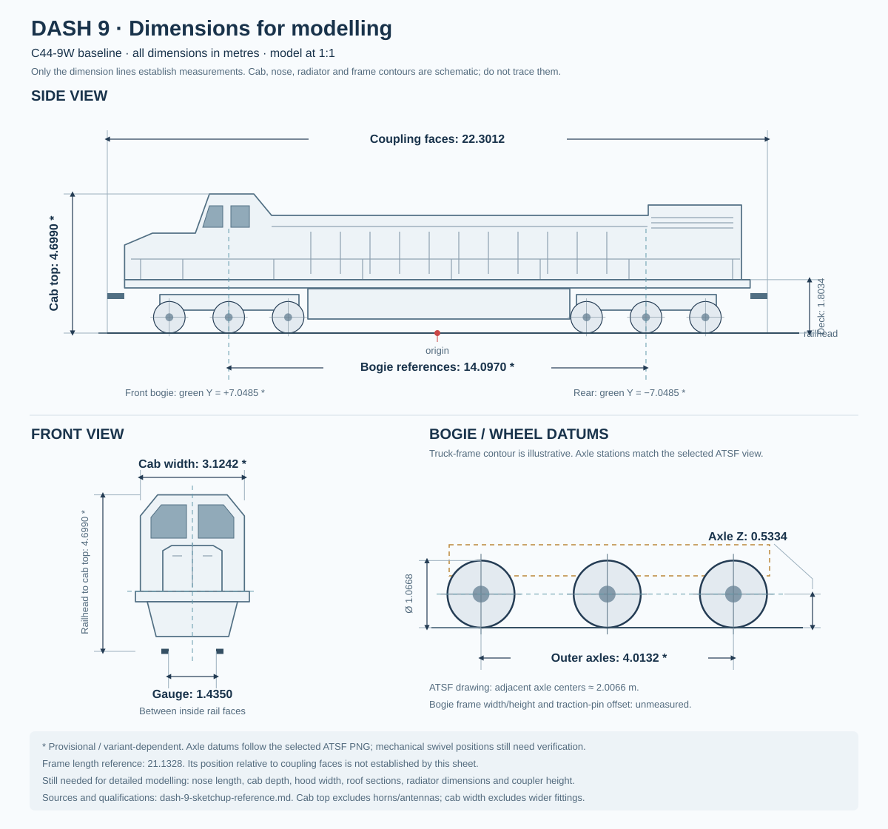
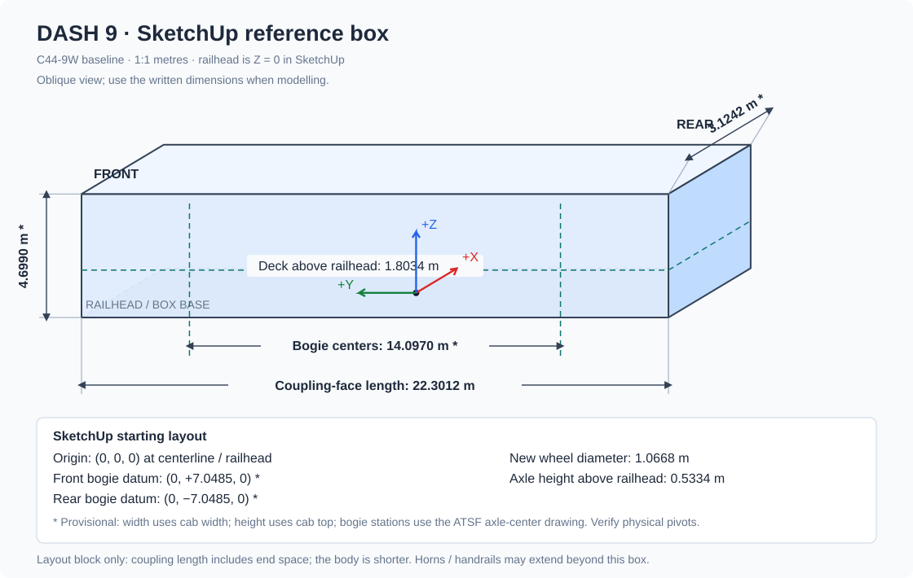
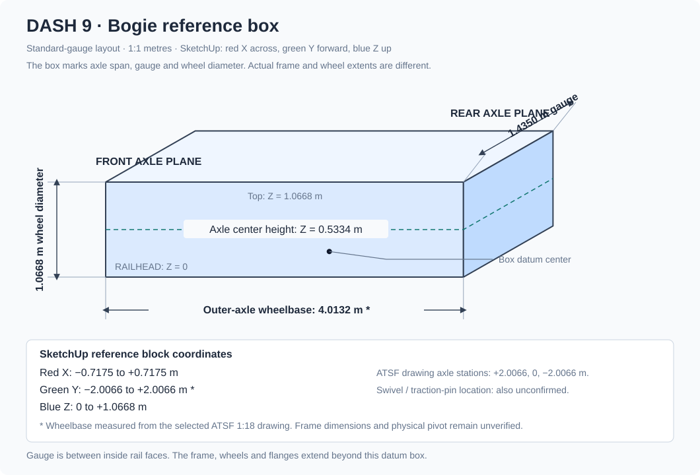

# GE Dash 9 — SketchUp dimensions and reference sources

Research checked **2026-11-16**. Model at **1:1 in metres**. Follow the [shared authoring guide](../sketchup-reference.md), [diesel guide](../diesel-sketchup-reference.md) and [bogie guide](../bogie-sketchup-reference.md).

## Selected drawing and corrected bogie dimensions

Use **1:18, ATSF 600–649, Phase 1a, early Hi-Ad trucks** from the Trainiax results page: [the exact side-view PNG](https://trainiax.net/drawings/18-ge/c-9/18-ge-dash9-44cw-atsf-1.png). Keep the same railway/production variant when selecting the opposite-side reference.

**Correction:** the earlier recommendation of **16.1544 m bogie spacing was incorrect for this reference**. Its **4.0640 m wheelbase also disagrees with this drawing**. They came from a conflicting data table and should not have been used as the modelling baseline. The selected ATSF drawing gives the following **drawing-derived** values; they are not newly verified GE factory dimensions:

| Datum | Native PNG measurement | Converted value |
| --- | --- | ---: |
| Front bogie axle-center X coordinates | approximately 384, 700, 1016 px | adjacent spacing approximately 2.0066 m |
| Rear bogie axle-center X coordinates | approximately 2604, 2920, 3236 px | adjacent spacing approximately 2.0066 m |
| Middle-axle to middle-axle distance across trucks | 2920 − 700 = 2220 px | approximately **14.0970 m** (46 ft 3 in) |
| Outer-axle span in one bogie | 1016 − 384 = 632 px | approximately **4.0132 m** (13 ft 2 in) |
| Symmetric bogie reference stations | half of 14.0970 m | approximately **±7.0485 m** |
| Axle height above railhead | railhead Y ≈ 864 px; axle Y ≈ 780 px | approximately **0.5334 m** |
| Deck height above railhead | 864 − 580 = 284 px | approximately **1.8034 m** |
| Cab-top height above railhead | 864 − 124 = 740 px | approximately **4.6990 m** |

Pixel coordinates are from the original **3621 × 956 px** PNG, with origin at its upper-left corner, and about 1–2 px picking uncertainty. The source's [scale convention](https://www.trainiax.net/medimension.php) is **4 pixels per prototype inch**, so multiply a pixel interval by **0.00635 m**. This convention and the selected image support the calculations above; dimensions measured from its silhouette still inherit the author's drawing accuracy.

If importing the **whole unresized PNG** into SketchUp, set its image width to **22.99335 m** (`3621 × 0.00635`). That includes image margins. Setting the whole image width to the locomotive coupling length would shrink the reference. Align the drawn **railhead**, rather than the image's bottom edge or footer, to model Z = 0. Do not multiply by 18 again after using this pixel conversion.

For this layout, move each old ±8.0772 m bogie reference **1.0287 m toward the locomotive center** to obtain ±7.0485 m. Use local axle stations about **+2.0066, 0, −2.0066 m** when matching the illustrated wheel centers. These are geometric axle datums; confirm the physical traction-pin center separately before claiming a mechanical swivel measurement.

The earlier bogie box also used **gauge** for its width and **wheel diameter** for its height. Those numbers describe reference datums, not the overall bogie frame. Even a correctly positioned datum box will be much smaller than the complete truck outline. Frame ends, brakes and suspension extend beyond the outer axle centers; flanges extend below tread contact level. Measure those extents separately from the selected view and a front/plan reference.

## Modelling dimension sheet

[Open the full-size dimension sheet](dash-9-modelling-measures.svg). It brings together coupling length, cab envelope, deck height, bogie references, gauge and wheel dimensions. Drawings use consistent scales within each view, with different scales between views. The nose, cab, radiator and truck-frame outlines are schematic, so use their labels rather than tracing the contours. Asterisks identify provisional or variant-dependent measurements. Axle stations match the selected ATSF drawing; physical pivot and frame extents still need separate verification.

The sheet does not establish nose length, cab depth, hood width, roof sections, radiator dimensions or coupler height. Those need a dimensioned drawing or measured references for the particular railway/road number. The source links and dimension qualifications below still apply.

## Reference box

[Open the reference drawing](dash-9-reference-box.svg). Start with a **22.3012 × 3.1242 × 4.6990 m** block at railhead level, centered longitudinally and laterally on the origin. Length is the coupling envelope; width and height use provisional cab dimensions. The diagram is a layout aid, not a body shape or a full clearance envelope. Bogie station marks project onto the visible side; the actual pivots sit on the vehicle centerline.

In SketchUp, draw a centered rectangle spanning red X from **−1.5621 to +1.5621 m** and green Y from **−11.1506 to +11.1506 m**, at blue Z = 0. Push/Pull upward **4.6990 m**. Add a horizontal guide at blue Z = **1.8034 m** for the deck, and crosswise guides at green Y = **±7.0485 m** for the drawing-derived bogie references. Keep the block in a reference group and hide it while detailing.

## Bogie reference box

[Open the bogie drawing](dash-9-bogie-reference-box.svg). This **4.0132 × 1.4350 × 1.0668 m** block marks the drawing-derived outer-axle span, standard track gauge and new-wheel diameter. The actual frame dimensions, outside wheel spacing and full wheel envelope extend differently; do not use this as a bogie shell.

In SketchUp, draw a reference rectangle at railhead level, with red X = **±0.7175 m** and green Y = **±2.0066 m**, and Push/Pull blue Z upward **1.0668 m**. Add a guide at blue Z = **0.5334 m** for axle height. Keep it in its own reference group. The rectangle's length endpoints locate the outer axle planes, rather than the frame ends.

For the selected ATSF drawing, use approximately **4.0132 m** outer-axle span and **±2.0066 m** local outer-axle stations. These are drawing-derived values from the audit above. The box center is a geometric datum; confirm the actual traction-pin position separately.

## Choose the version first

Use the North American **C44-9W / Dash 9-44CW** as the baseline below. Choose a railway, road number and date before detailing the cab, radiator grilles, lights and underframe. Canadian four-window cabs, later Canadian units, Brazilian export locomotives, and rebuilt units require their own reference set. A shared Dash 9 name does not establish identical dimensions.

## Sources to open while modelling

1. **[Michael Eby's Trainiax Dash 9 drawings](https://trainiax.net/mescaleloco-results.php?build=GE&dtype=UT&lrtype=L&rebuilt=N&scale36=1&type=Dash+9-44CW).** The page includes modern 1:18 drawings as well as older scales, with separate sides, production dates, railway/number ranges and revision notes. Use its 1:18 section first. These are the author's researched illustrations, rather than GE factory construction drawings. If the filtered link fails, open the [drawing index](https://www.trainiax.net/mescaleloco.php), select Undecorated → By Type → GE → Dash 9-44CW.
2. **[Trainiax Dash 9 production differences](https://trainiax.net/mephase-gedash9.php).** Useful for matching a particular cab, walkway, radiator and truck configuration instead of combining incompatible details. It identifies the Hi-Ad three-axle truck, 42-inch standard wheels and 71-inch standard deck height.
3. **[Jean-Denis Bachand's C44-9W data sheet and original side illustration](https://www.thedieselshop.us/DataC44-9.HTML).** A published modelling reference with useful main dimensions. Its table has ambiguous/inconsistent labels; the provisional values and conflicts below must be checked against the chosen variant. The illustration is also [linked directly here](https://www.thedieselshop.us/ge%209-44cw.gif). It is a side illustration, without dimension callouts.
4. **[Athearn's Dash 9 illustrated reference PDF](https://www.athearn.com/on/demandware.static/-/Sites-athearn-us-Library/default/dw270ac989/blog-pdfs/03_RTR_C44-9W_052314.pdf).** Pages 1–2 show side and end livery artwork for several railways and describe railway-specific features. Useful for color boundaries and front/rear appearance; it is a model manufacturer's product sheet, without factory dimension callouts. Its HO product dimensions are not full-size locomotive dimensions.
5. **[Kato's C44-9W page](https://katousa.com/n-ge-c44-9w/).** Independently lists the prototype length as 73 ft 2 in and describes the Hi-Ad trucks. Its shell/mechanism exploded diagrams help understand assemblies; miniature motor/chassis dimensions are not prototype measurements.

No verified GE factory general-arrangement drawing was located in this search. These links provide a useful modelling reference set; dimensions for individual panels, cab slopes and truck joints remain drawing/photo measurements until a dimensioned prototype diagram is available. External drawings remain linked at their publishers; no third-party artwork is bundled in the game.

## Working dimension sheet

Conversions use **1 inch = 0.0254 m exactly**. Decimal precision reflects conversion, not measurement accuracy.

| Measurement | Original | Metres | Basis / qualification |
| --- | ---: | ---: | --- |
| Standard coupling-face length | 73 ft 2 in | 22.3012 | Trainiax's length discussion; Kato also lists this length |
| Canadian coupling-face length | 73 ft 8 in | 22.4536 | Trainiax's Canadian version notes; do not apply universally |
| Standard frame length | 69 ft 4 in | 21.1328 | Trainiax's length discussion; frame is shorter than coupling envelope |
| Standard walkway/deck height | 5 ft 11 in | 1.8034 | Trainiax production notes; railhead datum |
| Standard new-wheel diameter | 42 in | 1.0668 | Trainiax production notes |
| New-wheel rolling radius | 21 in | 0.5334 | Derived from diameter |
| Bogie reference spacing, drawing-derived | approximately 46 ft 3 in | 14.0970 | Selected ATSF PNG: middle axle to middle axle; replaces the incorrect 53 ft baseline |
| Bogie outer-axle wheelbase, drawing-derived | approximately 13 ft 2 in | 4.0132 | Selected ATSF PNG: 632 px; replaces 13 ft 4 in for this reference |
| Cab width, provisional | 10 ft 3 in | 3.1242 | Bachand; excludes any unlisted protruding fittings |
| Cab-top height, provisional | 15 ft 5 in | 4.6990 | Bachand; does not establish horn/antenna clearance |

The frame and Canadian coupler measurements are explained in [Trainiax's 2009-02-01 research notes](https://www.trainiax.net/medrawupdate.php): Canadian coupling pockets can add length without a longer frame. The early four-window Canadian version also uses a lower walkway.

**Truck dimensions need particular care.** The selected ATSF PNG independently matches the 4.0132 m wheelbase; it should no longer be treated as a Canadian-only alternative. [Trainiax's photo-measurement example](https://www.trainiax.net/medrawmethods.php) uses **13 ft 2 in / 4.0132 m** wheelbase for a Canadian Dash 9-44CWL, with a **67.625 in / 1.717675 m** nominal walkway height. Those numbers describe that example; they do not resolve every standard C44-9W truck. Record the chosen axle stations rather than silently selecting a conflicting value.

Bachand also lists 66 ft 2 in under a truck-center label. Both that label and the separate 53 ft center entry fail the selected-image check. Neither value is an accepted truck datum for this ATSF reference. **Do not put 66 ft 2 in into `bogieCenters`.** Use the audited drawing-derived axle references above while seeking a factory diagram. The same table repeats implausible hood/walkway values; omitted entries should not be copied into the mesh.

## Initial SketchUp datums

Red X across, green +Y toward the short hood/cab front, blue +Z upward. Set the body origin to railhead level halfway between the two truck reference stations. The following is a **provisional symmetric layout**, derived from the standard length and audited 14.0970 m drawing-derived bogie reference spacing above:

| Datum | SketchUp (X, Y, Z), metres |
| --- | --- |
| Body origin | (0, 0, 0) |
| Front bogie reference | (0, +7.0485, 0) |
| Rear bogie reference | (0, -7.0485, 0) |
| Front coupling face | (0, +11.1506, measured coupler height) |
| Rear coupling face | (0, -11.1506, measured coupler height) |
| Wheel axle height, new 42-inch wheels | Z = 0.5334 |
| Standard deck surface | Z = 1.8034 |

Do not infer shell length or prototype coupler height from those coupling stations. Confirm any front/rear overhang asymmetry before finalizing the model. Bogie component origins are rail-level datums; wheelset origins are at the actual axle height. The final game axes map SketchUp `(X, Y, Z)` to `(-X, Z, Y)`, accounting for any conversion already performed by the exporter.

Each bogie needs **three separately named wheelsets**. The selected ATSF view shows adjacent axle spacing of approximately 2.0066 m. Record those drawing-derived stations in the source sheet, and verify the swivel/traction-pin location independently; an outer-axle span alone would not establish either. SketchUp axle rotation is around red X.

## Using the drawings for smaller details

[Trainiax explains its drawing scale and measurement method](https://www.trainiax.net/medimension.php). For original, unresized 1:18 images the convention is **4 pixels per prototype inch**; for 1:36 it is **2 pixels per prototype inch**. Thus a measured interval of `p` pixels converts to `p × 0.00635 m` or `p × 0.0127 m` respectively. Confirm the image has not been resized by the browser or image editor. Screen/print size labels alone do not establish dimensional accuracy.

Import an appropriate side image into a separate SketchUp reference group. Align railhead and wheel centers, calibrate using a known dimension with clearly identifiable endpoints, then lock the reference. Prefer truck stations or axle centers over fuzzy coupler outline edges. Cross-check length, deck height and wheel diameter independently. Trace the silhouette and panel positions only after the datums agree. Opposite sides differ; use both views and end photographs. A side view alone cannot establish cab width, nose cross-section or radiator overhang.

Trainiax's [dimension-source explanation](https://www.trainiax.net/medimension.php) explicitly describes many GE details as photo-derived. Label measurements obtained by tracing as estimates; a precise pixel-to-metre conversion does not turn them into factory dimensions.

## Model structure and integration notes

Use `body`, `bogie-front`, `bogie-rear`; keep fuel tank, cab, walkways and radiator with the body. Put `wheelset-01`, `wheelset-02`, `wheelset-03` within each bogie. Use the paint/material slots from the [shared guide](../sketchup-reference.md) and separate fixed railway lettering from selectable paint.

Supply the chosen road number/date, wheel/axle and truck reference dimensions, shell/clearance/coupler envelope, gauge, operating mass and sourced physics values with the export. The catalog includes the v2 SketchUp model as **GE Dash 9 · SketchUp prototype**, with separate authored body and bogie frames and temporary three-axle wheelsets. The browser uses converted geometry; Godot uses the exported GLB.

## Current game import workflow

1. Export the SketchUp assembly as **COLLADA (`.dae`)**, replacing `public/models/locomotives/dash-9/dash9.dae`.
2. Keep the three main components named `body`, `bogie_front` and `bogie_rear` (hyphens are accepted too). Set the body origin at the centerline/railhead datum and both bogie origins at their intended rail-level pivots, symmetrically placed about the body origin. Export component hierarchy; keep reference images and dimensions out of the assembly.
3. Run **`npm run import:dash9`** from the project directory. It writes `src/train/assets/dash9.json`. Keep that generated file with the source export; do not edit its vertex arrays manually. The command validates component names and pivot locations, honors declared units, corrects mirrored face winding, and omits SketchUp edge lines/cameras.
4. For Godot, run **`node scripts/export-godot-assets.mjs --vehicle=ge-dash9`** to replace only this model's GLB and refresh its catalog metadata, then let Godot reimport the asset. Start the game, build **1,435 mm track**, and select **GE Dash 9 · SketchUp prototype** from the vehicle catalog. It supports the normal train editor, translucent placement, reversing, independent bogie poses and instancing.
5. Re-run the import command after every re-export. `npm run import:dash9 -- --check` checks whether generated data matches the source; tests also detect stale generated data. Reload the browser after rebuilding if using a production preview.

The initial integration supports static triangle geometry and **solid-color** materials. It reports unsupported texture/animation data explicitly. Material colors/names are retained; runtime materials use a standard rough surface approximation. Player-selected paint colors and arbitrary asset registration still require additional work. GLB export is unnecessary for this working COLLADA path.

**Current v2 asset:** `.files/dash-9/dash9.dae` replaces the original bounding-box model. Imported mesh bounds are approximately **3.660552 × 4.699 × 21.673018 m** (width × height × length), with **14.097 m** between bogie pivots. These are measurements of the authored export, preserved without rescaling. Temporary procedural wheelsets still use a 4.064 m outer-axle span. The importer discards collapsed faces from the COLLADA mesh while preserving valid geometry, materials and component pivots.

The checked export declares inches (`0.0254` metres per unit) and Z-up; conversion produces the measured body dimensions approximately **3.1242 × 4.6990 × 22.3012 m** (game X/Y/Z), and **16.1544 m** between authored bogie pivots. The adapter follows the named front bogie toward game +Z. In this export the named front is toward SketchUp negative green Y, so its recorded mapping is `(X, Z, -Y)`; exports following the general +green-front convention receive the corresponding yaw correction. No scale-to-fit correction is applied.

Temporary wheels use 0.5334 m rolling radius, 1,435 mm gauge and axle stations **+2.032, 0, -2.032 m** within each bogie. Equal spacing is a gameplay placeholder, not a resolved Hi-Ad drawing measurement. The imported frame is preserved. When authored wheelsets are supplied, the temporary wheelset builder must be removed/disabled to avoid duplicate wheels. The imported box spans the current coupling envelope, so no extra procedural shell, tank or couplers are added over it.

The catalog uses a nominal 4,400 hp / 3,281,080 W power rating. Until a specific prototype is chosen, **181,437 kg operating mass, 600,000 N tractive effort and 31.2928 m/s (70 mph) top speed are gameplay assumptions**, not measurements from the COLLADA file. Vehicle geometry does not establish physics specifications. Body and bogie dimensions update from the imported geometry/pivots; gauge, temporary wheel dimensions and physics stay explicit in the vehicle/catalog definitions.
