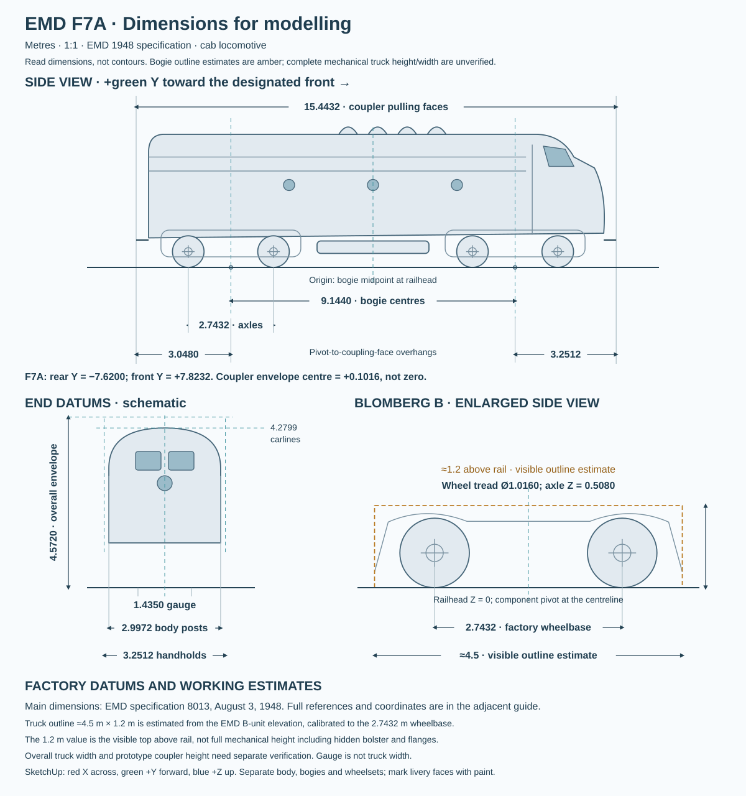

# EMD F7A — SketchUp modelling reference

Checked **2026-11-23**. Model at **1:1 in metres**. This is the F7A cab locomotive, not the longer FP7 or six-axle E8. The [F7B powered booster](../f7b/f7b-sketchup-reference.md) is a separate vehicle with its own body, bogies and couplers. Do not combine an A/B pair into one model.

Follow the [shared authoring guide](../../sketchup-reference.md), [diesel guide](../../diesel-sketchup-reference.md), [bogie guide](../../bogie-sketchup-reference.md) and [headlight guide](../../headlight-sketchup-reference.md). Use prototype dimensions rather than the old procedural F7A mesh.

## Dimension sheet



[Open full-size SVG](f7a-modelling-measures.svg). Dimension lines establish datums; nose, window, roof and frame contours are schematic, not outlines to trace.

## Principal dimensions

Baseline: **EMD Specification 8013, August 3, 1948**, section 1. The [original combined F7A/F7B specification](https://static1.squarespace.com/static/624efffd8ef1885fd8ab5ca1/t/67f0fb0fc36f4c2cecfc6b0c/1743846159792/EMD-SPEC-LOCO-F7A-F7B-1948.pdf) has the A-unit table on **PDF page 3**, and its tiled arrangement drawing on **PDF pages 19–23**. These are one-based PDF page numbers.

| Measurement | Metres | Original / interpretation |
| --- | ---: | --- |
| Coupler pulling face to pulling face | **15.4432** | 50 ft 8 in; coupling envelope, not shell length |
| Width across body posts | **2.9972** | 9 ft 10 in; structural body datum |
| Width over handholds | **3.2512** | 10 ft 8 in; fittings envelope |
| Railhead to top of carlines | **4.2799** | 14 ft 0½ in; roof framing datum |
| Overall height over horns, 1948 specification | **4.5720** | 15 ft; equipment envelope |
| Bogie bolster/swivel centre spacing | **9.1440** | 30 ft |
| Front coupling face to front bogie centre | **3.2512** | 10 ft 8 in |
| Rear bogie centre to rear coupling face | **3.0480** | 10 ft; derived from the length chain |
| Axle spacing within either bogie | **2.7432** | 9 ft |
| Outermost axle-centre span | **11.8872** | 39 ft; not bogie pivot spacing |
| Nominal new wheel tread diameter | **1.0160** | 40 in |
| Axle height above railhead | **0.5080** | New-wheel rolling radius |
| Track gauge | **1.4350** | Inside rail faces; not truck width |

Conversions use 1 inch = 0.0254 m exactly. Extra decimals reflect conversion, not manufacturing tolerances.

**Heights need the correct datum.** The [later EMD operating manual, General Data](https://lctm.info/Secciones/Trenes/LocoMes/GRR_F7/_media/f7-om.pdf) lists **4.55295 m / 14 ft 11¼ in over horns** instead. This sheet consistently uses the 1948 specification's **4.5720 m** envelope. Match fittings to your chosen road number/date; neither overall height is a flat shell-roof height. The 4.2799 m carline dimension describes roof framing, not the precise outside roof sheet. The body-post width likewise does not establish every sheet-metal projection.

## Axes, origin and layout

SketchUp: **red X across**, **green +Y toward the nose**, **blue +Z up**. Origin: railhead level halfway between bogie pivots. The standard proper-handed mapping is SketchUp `(X,Y,Z)` → game `(-X,Z,Y)`, allowing for any conversion already applied by the exporter.

| Datum | SketchUp coordinates, metres |
| --- | --- |
| Model origin | `(0,0,0)` |
| Front / rear bogie origins | `(0,+4.5720,0)` / `(0,-4.5720,0)` |
| Front bogie axle centres | `(0,+5.9436,0.5080)` and `(0,+3.2004,0.5080)` |
| Rear bogie axle centres | `(0,-3.2004,0.5080)` and `(0,-5.9436,0.5080)` |
| Front coupling-face plane | `Y = +7.8232` |
| Rear coupling-face plane | `Y = -7.6200` |
| Body-post width guides | `X = ±1.4986` |
| Handhold envelope guides | `X = ±1.6256` |

**The F7A coupling envelope is asymmetric about the bogie midpoint:** its centre is at `Y = +0.1016`. With this origin, `±7.7216` would be incorrect prototype coupling stations. Preserve the correct geometry; its eventual importer/placement definition must account for these offsets instead of stretching the locomotive to fit a symmetric convention.

Coupler vertical height is not established by these dimensions. The old game model uses **0.8800 m as a modelling placeholder**, not a verified prototype measurement. Keep that labelled as provisional until the selected unit's coupling-height reference is established. Locate a pulling face, not the extreme knuckle tip.

## Bogies: length, height and wheel datums

Use two powered **Blomberg B** bogies. All four axles are powered.

| Bogie measurement | Working value | Confidence / boundary |
| --- | ---: | --- |
| Axle-to-axle wheelbase | **2.7432 m** | Factory dimension |
| New wheel tread diameter | **1.0160 m** | Factory dimension |
| Visible length including end brake rigging | **about 4.5 m** | Drawing estimate; roughly ±0.1 m |
| Visible top above railhead | **about 1.2 m** | Drawing estimate; roughly ±0.05 m |
| Complete mechanical height including hidden bolster/flanges | **Not verified** | Not the same as visible height above rail |
| Overall truck width | **Not verified** | Establish from a front/plan reference; never substitute gauge |

**How the outline estimates were obtained:** the same EMD scan's B-unit elevation on **PDF page 42** was calibrated to the 9 ft axle spacing. Render PDF rectangle `(155,535)–(355,603)` points at 4×: axle centres are approximately `(191,169)` and `(625,169)` pixels, brake ends X ≈ `55…769`, rail Y ≈ `251`, frame top Y ≈ `61`. Scale ≈ `2.7432 / 434 = 0.00632 m/pixel`, giving about **4.51 m length** and **1.20 m above rail**. Line thickness, scan distortion and body-mounted equipment limit accuracy; these are not additional factory callouts.

Start with a hidden **4.5 m long × 1.2 m high side-reference rectangle**, local Y `±2.25`, Z `0…1.2`. This is a blocking aid, not a complete mechanical envelope. Do not extrude it using 1.435 m as truck width. Flanges extend below railhead; tread diameter excludes the flange.

For each bogie, put its own origin at the rail-level swivel datum. Wheelset origins are local **`(0,+1.3716,0.5080)`** and **`(0,-1.3716,0.5080)`**. Model the physical bolster/bearing at its actual height rather than moving the component origin up to it.

## Components and build sequence

```text
emd-f7a
  body
    shell-and-nose
    cab-glazing
    roof-fans
    underframe-and-tanks
    coupler-front
    coupler-rear
    fittings-and-lights
  bogie-front
    frame
    wheelset-01
    wheelset-02
  bogie-rear
    frame
    wheelset-01
    wheelset-02
```

1. Make a reference coupling-envelope box: X `±1.6256`, Y `-7.6200…+7.8232`, Z `0…4.5720`. Add body-post guides at X `±1.4986` and carline height at Z `4.2799`. Keep the reference box out of the exported mesh.
2. Place bogie and wheelset datums. Check the **11.8872 m** outer axle span before shaping the nose.
3. Shape the cab, curved nose and roof using the manufacturer's elevation/plan views and photographs. The overall box does not establish nose length, window dimensions or roof curvature.
4. Build one reusable Blomberg B component and instance it twice. Keep `body`, `bogie-front`, `bogie-rear` as siblings. Body steps and tanks remain with the body. Motors, brakes and journals belong to the truck.
5. `wheelset-01` belongs to the bogie's own local +Y end. If the prototype calls for the rear truck to face the opposite way, rotate its instance 180° around blue Z; retain its child names. Rotation is different from a negative-scale mirror.
6. Add the chosen unit's fans, grilles, horns, lights, pilots and handholds. Record exhaust/lamp positions using the shared guides. Do not turn a generic 1948 arrangement into a claimed Santa Fe-specific blueprint without matching photos.

## Paint, export and import

Apply the exact material **`paint` directly to outward faces** intended for the livery atlas: sides, nose, roof and end panels as appropriate. A magenta placeholder helps identify them. Keep glass, wheels, bogies, hoses and small fittings in their normal materials. Group-only paint assignments and copies named `paint1` do not replace this marker.

Deliver **`f7a.skp` and `f7a.dae`**, independently of the F7B. Preserve component hierarchy, names and materials; enable triangulation, disable export edges and two-sided faces. Texture-map export may remain enabled. Check the DAE's declared unit: SketchUp may declare inches despite displaying metres, so the importer must convert exactly once.

Include pivot coordinates, wheel radius, designated front, rear truck rest rotation, coupler planes and provisional measurements in a delivery note. The native importer maps authored `bogie-front`/`bogie-rear` to runtime part names. The existing Dash 9 script contains vehicle-specific dimensions and axle-count checks; an F7A adapter must account for two axles per truck and the asymmetric coupling envelope. This document does not change catalog entries or game assets.

## Drawing selection

Use the [Trainiax F7A selector](https://trainiax.net/mescaleloco-results.php?build=EMD&dtype=UT&type=F7A&rebuilt=N&lrtype=L&scale18=1&scale36=1&scale55=1) to match a railway/phase. Calibrate a side image against **2.7432 m axle spacing** or **9.1440 m bogie centres**, then check the coupling span. Do not scale the image's entire width to locomotive length: its margins count toward image width. Manufacturer datums take priority over a conflicting illustration.

## F7A v1 paint kit

The authored `.files/f7a/f7a-v1.dae` now has a separate **4096 × 4096** UV kit in `.files/f7a/uv-paint-only/v1/`. Paint **`f7a-v1-uv-basecolor.png`**, with **`f7a-v1-uv-layout.png`** as a temporary guide layer. The labeled guide, checker texture, two-view preview, UV-only DAE, textured DAE and ZIP are alongside it. The original SKP/DAE and game assets are unchanged.

Only the exact authored `paint` faces are mapped. Left side has the front at right; right side has the front at left. The roof, front and rear have their own views, with secondary painted surfaces packed separately. Sloped/curved surfaces use projection, so scale varies with slope. Some side surfaces at different depths intentionally share projected artwork to keep stripes aligned; they are recorded separately from unintended overlaps in `uv-report.json`.

Regenerate v1 with `python -B scripts/generate-f7a-uv.py --version v1` and validate with `python scripts/check-f7a-uv.py --version v1`. The generator needs NumPy, Pillow and xatlas, installed into `.tmp/uv-tools` using `python -m pip install --target .tmp/uv-tools numpy pillow xatlas`. Regenerating overwrites the generated basecolor; copy your painted texture elsewhere first.

## Imported Godot vehicle

The current **v5** working model and `.files/f7a/f7a v5 santa fe.png` are available as catalog vehicle **F7A**, ID `emd-f7a`. V5 imports the corrected authored faces, rebuilds their AI-oriented UV layout and uses a fresh Santa Fe texture generated from the user's real No. 49 photographs and the v5 guide. The earlier adapted texture is retained in the rejected iteration history. The sides and roof share a physical scale, with grouped small parts and guide-only distance markers. Opposite sides preserve their natural viewing directions so lettering is not mirrored. The procedural `atsf-f7a` entry remains available. Run **`node scripts/import-godot-f7a.mjs --version=v5`** from the repository root to rebuild the native GLB, copy the Santa Fe livery and update this entry and its sound mapping. Use `--version=v1` or `--version=v2` to import an earlier kit explicitly. The converter uses the existing Node dependencies in `web/node_modules`; it does not edit browser assets.

The native model is `godot/assets/vehicles/emd-f7a-1435.glb`, supporting 1,435 mm track. It preserves the authored 9.144 m pivot spacing and all four wheelset components, with 948 textured triangles and 5,859 solid-material triangles. The exporter also supplied 177 collapsed triangles, which are omitted. The finished atlas is retained at its supplied **1,254 × 1,254** resolution; normalized UVs use the same layout as the original 4,096-square template.

The current kit is in `.files/f7a/uv-paint-only/v5/`, including the final texture, UV guide, textured/checker COLLADA copies, seven-view review and iteration history. It retains five main painting views and a secondary area. Validate with `python scripts/check-f7a-uv.py --version v5`. Only rebuild UVs when needed, using `python -B scripts/generate-f7a-uv.py --version v5`; this overwrites generated templates and preview bindings. The finished source texture remains outside the generated kit. See `iteration-notes.md` inside the kit for the built-in image-generation prompts, actual rendering checks and review limits. Earlier v1/v2/v3/v4 kits remain separate. The generated v5 texture is 1254 square; the authoring guide is 4096 square. Group names are retained for authoring but stripped from runtime materials; identical paint surfaces share one livery material.

Geometry is not rescaled. Its measured envelope is approximately **3.1972 m wide**, **14.8739 m long**, and extends from **0.0706 m below railhead** to **4.4827 m above railhead**. Catalog placement retains the existing symmetric **15.4432 m coupling envelope** and F7A physics specifications. Exact asymmetric coupling-face support described above remains a placement-system extension; the authored geometry is not distorted to simulate it. The two smoke outlets follow the authored exhaust stacks, and engine/horn audio use the F7 profile.

Use `--suite=f7a-import` with the native C# test runner to check catalog identity, pivots, wheelsets, texture binding, hardware materials, instancing and horn availability. With a real renderer it also writes `.godot/f7a-import-preview.png`.

Add `--f7a-review=f7a-review-name` to capture both front quarters, left, right, front, rear and roof into `godot/.godot/f7a-review-name/`. `python -B scripts/review-f7a-texture.py --version v5 --iteration review-name` independently renders the exported GLB and traces its painted triangles back to the authored material groups, with sampled UV-seam diagnostics. Seam-color differences are diagnostic only: intentional paint borders and material changes are not mapping failures.
