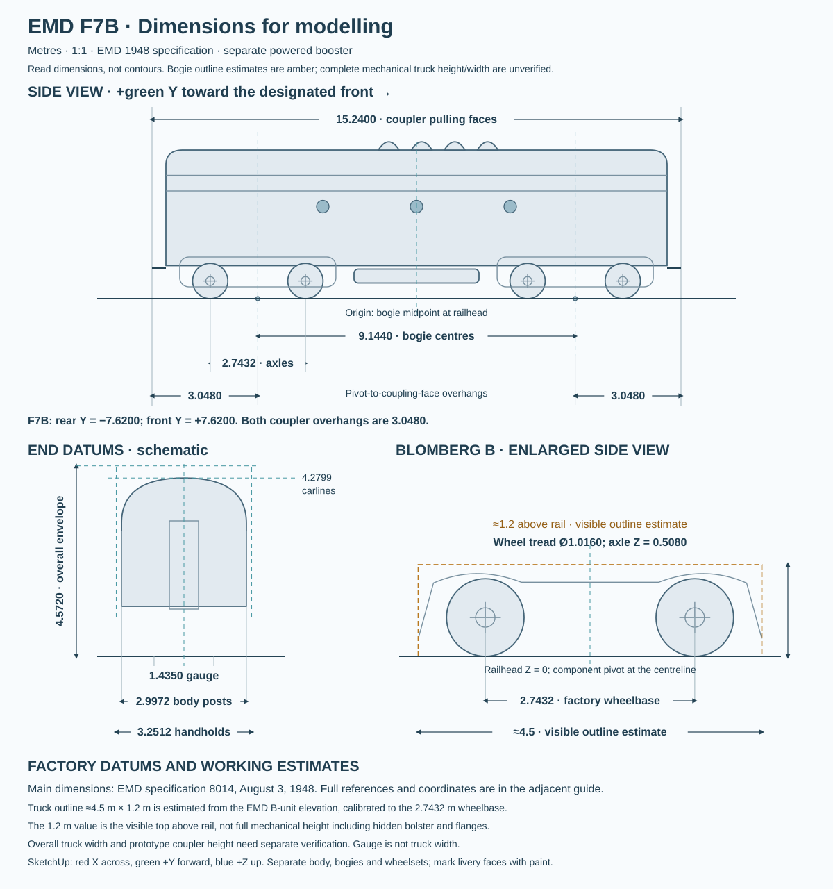

# EMD F7B — SketchUp modelling reference

Checked **2026-11-23**. Model at **1:1 in metres**. The F7B is a **powered cabless booster locomotive**, with its own engine, generator and four powered axles. Make it a separate vehicle from the [F7A](../f7a/f7a-sketchup-reference.md), with independent body, trucks and couplers. Supply separate `f7b.skp` and `f7b.dae` files rather than a combined A+B object.

Follow the [shared authoring guide](../../sketchup-reference.md), [diesel guide](../../diesel-sketchup-reference.md), [bogie guide](../../bogie-sketchup-reference.md) and [headlight guide](../../headlight-sketchup-reference.md).

## Dimension sheet



[Open full-size SVG](f7b-modelling-measures.svg). Dimension lines establish the datums. The contours are schematic; use prototype arrangement views and photographs for shapes.

## Principal dimensions

Baseline: **EMD Specification 8014, August 3, 1948**, section 1. In the [original combined F7A/F7B specification scan](https://static1.squarespace.com/static/624efffd8ef1885fd8ab5ca1/t/67f0fb0fc36f4c2cecfc6b0c/1743846159792/EMD-SPEC-LOCO-F7A-F7B-1948.pdf), the booster table is on **PDF page 26**, and the tiled B-unit arrangement is on **PDF pages 41–45**. These are one-based PDF page numbers.

| Measurement | Metres | Original / interpretation |
| --- | ---: | --- |
| Coupler pulling face to pulling face | **15.2400** | 50 ft; 0.2032 m shorter than F7A |
| Width across body posts | **2.9972** | 9 ft 10 in; structural body datum |
| Width over handholds | **3.2512** | 10 ft 8 in; fittings envelope |
| Railhead to top of carlines | **4.2799** | 14 ft 0½ in; roof framing datum |
| Overall height over fan housings, 1948 specification | **4.5720** | 15 ft; equipment envelope |
| Bogie bolster/swivel centre spacing | **9.1440** | 30 ft |
| Front coupler face to front truck centre | **3.0480** | 10 ft |
| Rear truck centre to rear coupler face | **3.0480** | Derived from the full length chain |
| Axle spacing within each bogie | **2.7432** | 9 ft |
| Outermost axle-centre span | **11.8872** | 39 ft; not bogie pivot spacing |
| Nominal new wheel tread diameter | **1.0160** | 40 in |
| New-wheel axle height above railhead | **0.5080** | Half the tread diameter |
| Track gauge | **1.4350** | Inside rail faces |

Conversions use 1 inch = 0.0254 m exactly. Body-post width does not establish every sheet-metal projection. The carline height is a roof-framing datum, while the overall height includes fan housings. Do not make the whole flat shell 4.5720 m tall.

The F7B has no F7A nose/front cab. Define a stable front end on the measurement sheet and match doors, portholes, grilles, gangways, steam-generator equipment and roof fans to the chosen unit/date. Reversing the vehicle in a train does not change its component names.

## Axes and stations

SketchUp: **red X across**, **green +Y toward designated front**, **blue +Z up**. Place the origin at railhead level midway between bogie pivots. The standard proper-handed conversion is SketchUp `(X,Y,Z)` → game `(-X,Z,Y)`, allowing for exporter conversions already applied.

| Datum | SketchUp coordinates, metres |
| --- | --- |
| Model origin | `(0,0,0)` |
| Front / rear bogie origins | `(0,+4.5720,0)` / `(0,-4.5720,0)` |
| Front bogie axle centres | `(0,+5.9436,0.5080)` and `(0,+3.2004,0.5080)` |
| Rear bogie axle centres | `(0,-3.2004,0.5080)` and `(0,-5.9436,0.5080)` |
| Front / rear coupling-face planes | `Y = +7.6200` / `Y = -7.6200` |
| Body-post width guides | `X = ±1.4986` |
| Handhold envelope guides | `X = ±1.6256` |

The B-unit coupling envelope is centred on the bogie midpoint. **Do not copy the F7A's asymmetric coupling stations.** Coupler height is not established here; the old game's 0.8800 m is a labelled modelling placeholder until a prototype height is verified.

## Powered Blomberg B bogies

Reuse the F7A bogie definition where the prototype's brakes, journals and fittings match. Each assembled locomotive retains its own two independently turning truck instances.

| Bogie dimension | Working value | Confidence / boundary |
| --- | ---: | --- |
| Axle spacing | **2.7432 m** | Factory dimension |
| New wheel tread diameter / radius | **1.0160 / 0.5080 m** | Factory diameter / derived radius |
| Visible length including end brakes | **about 4.5 m** | Drawing estimate; roughly ±0.1 m |
| Visible top above railhead | **about 1.2 m** | Drawing estimate; roughly ±0.05 m |
| Complete mechanical height, including hidden parts/flanges | **Not verified** | Not the visible height above rail |
| Overall truck width | **Not verified** | Track gauge is not this dimension |

The outline estimates come from the B-unit elevation on **PDF page 42**, scaled using the axle spacing. See the [F7A bogie measurement method](../f7a/f7a-sketchup-reference.md#bogies-length-height-and-wheel-datums) for pixel datums. Keep a hidden **4.5 m × 1.2 m side-reference rectangle** centred on the pivot. Do not mistake a 2.7432 m wheelbase × 1.0160 m wheel-diameter box for the complete truck. Do not use gauge as its overall width.

Within each truck, origin is `(0,0,0)` at its rail-level swivel datum. Wheelset origins are **`(0,+1.3716,0.5080)`** and **`(0,-1.3716,0.5080)`**. Wheels rotate around red X. Flanges extend below railhead; the tread diameter excludes them. Wheelset `01` is at the bogie's own local +Y end, even if its rear instance is rotated 180° about blue Z.

## Hierarchy and build order

```text
emd-f7b
  body
    shell
    roof-fans-and-hatches
    grilles-and-portholes
    underframe-and-tanks
    gangway-front
    gangway-rear
    coupler-front
    coupler-rear
    fittings
  bogie-front
    frame
    wheelset-01
    wheelset-02
  bogie-rear
    frame
    wheelset-01
    wheelset-02
```

1. Make a hidden reference envelope: X `±1.6256`, Y `±7.6200`, Z `0…4.5720`. Add narrower body-post guides at X `±1.4986` and carline height at Z `4.2799`. The coupling envelope is not the actual shell length.
2. Place truck and axle datums. Cross-check the **11.8872 m** outer axle span against your side reference.
3. Shape the roof and flat ends from the manufacturer arrangement. Detail doors, gangways, portholes, intakes and roof apparatus for the selected unit. The front/rear equipment is not necessarily mirror-symmetric.
4. Keep `body`, `bogie-front`, `bogie-rear` as siblings. Body steps and tanks remain fixed to the body; running gear stays with its bogie. Use a 180° rotation where appropriate instead of exporting a negative-scale mirror.
5. Apply the exact material **`paint` directly to outward faces** intended for the shared livery atlas. A magenta placeholder is useful. Keep glass, wheels, bogies, hoses and minor fittings in their normal materials; painting only a containing group is insufficient.

## Export and delivery

Deliver separate editable source and COLLADA files, textures if present, and a measurement note with front direction, pivot positions, wheel radius, coupling-face stations, rear bogie rest rotation and provisional measurements.

Preserve component hierarchy and material names. Enable triangulation; disable edges and two-sided faces. Texture-map export can remain on. Check the declared unit and axis mapping: the importer must convert inches/metres and Z-up/Y-up exactly once.

The F7B will need its own **powered vehicle definition and import adapter** when integrated into Godot. It is not a livery/variant selector of the F7A, and it is not a passenger car. Reusing bogie geometry does not merge the two vehicles. The Dash 9 importer is vehicle-specific; its three-axle checks must not be reused unchanged. Naming components alone does not register the model in the game.

## Drawing selection

The [Trainiax F7B selector](https://trainiax.net/mescaleloco-results.php?build=EMD&dtype=UT&type=F7B&rebuilt=N&lrtype=L&scale18=1&scale36=1&scale55=1) can help match a railway/phase. Calibrate using axle spacing or bogie centres with clearly visible endpoints, then cross-check coupling length. Preserve credits. Image margins are not part of the prototype coupling span; factory dimensions take priority over a conflicting illustration.
